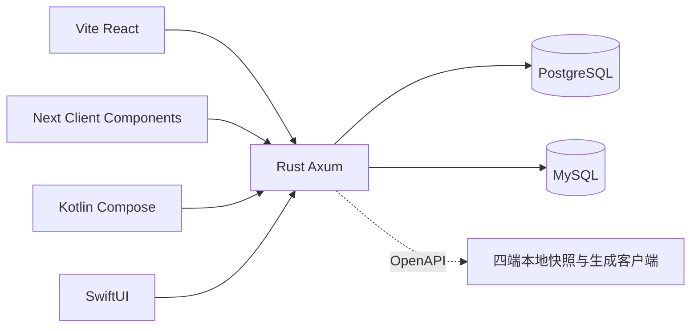

# v0.1.0 技术架构

更新：2026-10-21。本次按已批准方案整体换新 Next / Backend，Backend 冲突以上游为准。范围见 [需求](requirements.md)，实际验收见 [交付计划](delivery-plan.md)。

## 工程与职责

五端分别安装、生成与构建。SPA / Next 各有 npm、锁文件、OpenAPI 输入、语言资源和工具配置；Backend 使用 Cargo，Android 使用 Gradle Wrapper，iOS 使用 XcodeGen / CocoaPods / Xcode。根目录不建立 JS workspace 或共享运行时源码。

Rust 是业务与授权的唯一实现来源。Next 公共页面与 Metadata 由 Server Components 渲染，私有 Client Components 直接请求 Rust；认证连接器只在客户端图中使用。登录、刷新、退出和数据缓存按当前用户隔离。

## 上游基线与模块

- Backend 基于 6df373d98b573e8155cd1d1931065aa16af81598，使用 Axum 0.8.9、SQLx 0.9、Rust stable / edition 2024。Cargo.lock 固定依赖，验证证据记录实际工具链版本。
- bootstrap 按 Settings 组装健康与可选业务依赖；api 负责路由、中间件、响应和 OpenAPI；domain 包含 health / auth / items；platform 包含只读配置、数据库、令牌密码连接器与日志。
- PostgreSQL / MySQL 使用强类型连接池，业务仓储分别实现参数化 SQL。迁移显式执行，目录为 migrations/postgres / migrations/mysql。
- Next 基于 81e089fbcc06a237353e2107bd578d20567dfba3，使用 app / components / lib / stores / locales / styles 组织。Tailwind、shadcn 和 next-themes 管理界面；next-intl 管理 locale 根布局与路由；TanStack Query 管理服务器数据；Zustand 仅管理必要 UI 偏好。
- Next 使用 React Compiler、国际化校验和原生本地检查。当前适配排除 PWA / Service Worker。
- SPA 保留现有 Vite / React 结构；Android 和 iOS 保留平台原生 UI、环境及安全存储，只适配新 API。

所有端保留完整 zh-CN / en 与浅色 / 深色 / 系统主题。Next 界面采用上游温和纸面色、绿色强调、细分隔线和清晰的任务列表；动效用于操作与状态反馈，并尊重 reduced-motion。

## OpenAPI 与传输

Rust DTO 与路由元信息离线导出 OpenAPI 3.1 至 docs/contracts/openapi.json。四端保存本地副本并分别生成：Web 使用 Hey API，Android 使用 OpenAPI Generator kotlin / jvm-retrofit2，iOS 使用 Apple Swift OpenAPI Generator 的原生 build plugin。生成代码不手改。

成功响应为 {code,message,data}，code 为真实 HTTP 状态字符串，message 为 success。204 不返回正文。错误为 {code,message,details?}；业务 details.reason 为稳定本地化键，客户端也支持按 HTTP 状态映射。时间为整数 epoch 毫秒。

JSON 语法错误 / 超限 / Content-Type / 数据结构分别保留 400 / 413 / 415 / 422，业务校验为 400。请求 ID 按上游中间件生成与传播。Rust OpenAPI 的包装 data 引用命名 DTO，details 为可选命名对象，保证三种语言生成器复用同一类型。

根 scripts/contracts.sh 只复制与调用本端生成器；check 导出到临时目录并只读比对，不静默写回。Next SDK 位于 lib/api/generated，SPA 位于 src/api/generated。

## 数据与事务

identities 保存 UUID 和来源身份；accounts 保存区分大小写的唯一用户名与 Argon2id 散列；auth_sessions 保存账号、refresh 散列、绝对期限和撤销时间；items 通过 owner_id 外键隔离数据。

PostgreSQL 使用原生 UUID / TIMESTAMPTZ；MySQL 使用 BINARY(16) / TIMESTAMP(3)、InnoDB 与 utf8mb4_bin。两库都约束 title 的 UTF-8 字节数与正版本号，索引覆盖 owner / created_at / id。已应用 PostgreSQL 迁移保留版本与字节内容，新增 MySQL 同语义迁移。

Item 写入先锁定属于当前用户的行，再判断 version；他人资源与未知 ID 均为 404，旧版本为 409，失败事务不修改数据。分页计数和内容处于同一 repeatable-read 快照。MySQL 在写入事务内查询结果，不依赖 RETURNING。

## 认证与状态

所有客户端通过应用内用户名密码请求 Rust。Argon2id 验证密码，HS256 access JWT 有效 15 分钟，校验 issuer / audience / exp / sub / sid 与数据库会话。30 天不透明 refresh token 只保存 SHA-256 散列，行锁事务单次轮换；并发消费同一旧凭证只有一次成功。logout 撤销当前会话并立即使两类凭证失效。

Web access 仅在内存，refresh 使用当前标签页 sessionStorage；Android 使用 Tink / Keystore，iOS 使用 Keychain。客户端串行刷新，退出后的迟到结果不能恢复旧用户，非幂等写入不自动重试。语言切换和页面刷新需验证登录恢复，清理退出后的私有缓存。

## 配置、启动与交付

配置优先级为默认值、当前目录 .env、进程环境。APP_HTTP__BIND_ADDR、APP_DATABASE__URL、连接限制 / 超时、日志参数采用上游结构；APP_AUTH__JWT_SECRET 为业务扩展。旧后端配置名不做 fallback。配置读取不修改进程环境，也不记录密钥或数据库凭证。

上游 lazy pool 允许无数据库或数据库暂不可用时启动 HTTP；/health 为 200，/ready 为 503，数据库恢复后就绪探针自动恢复。业务数据库或签名密钥缺失时相关接口为 503。CORS 遵循上游宽松策略。开发可选原生数据库或上游 Compose profiles，不修改用户已有服务。

Next 产出 standalone，postbuild 复制 public / static；Rust 产出 API / migrate / create-user，并随迁移工具提供 migrations。SPA 继续提供静态产物与 Nginx 示例。移动环境见 [双环境](mobile-environments.md)，最低设备仍为 Android 14 / iOS 18。

## 本地验证

本轮验证覆盖两库真实迁移 / HTTP / JWT / 事务、四端生成与编译、Web 真实浏览器、移动可用系统矩阵、独立复制和部署产物。根 verify 显式使用 quick / full；full 只代表所选目标与环境，完整交付需两库及各平台证据。

原始日志、截图、测试环境放忽略的 .ailog；可分享结果进入 docs/verification。历史通过不代替新改动结果，未执行项在交付计划中明确保留。AGENTS 与本端 README 是原生命令入口；不自动提交、推送或部署。
